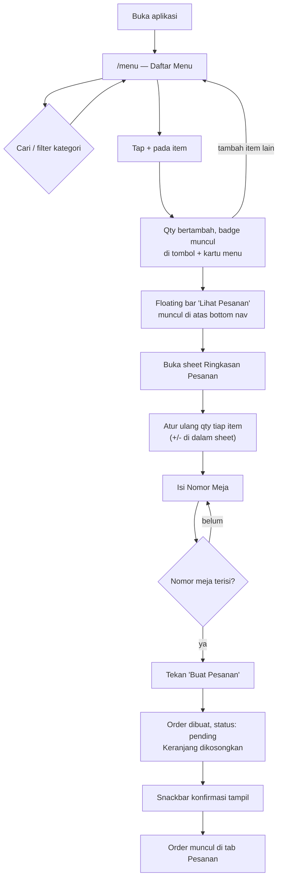
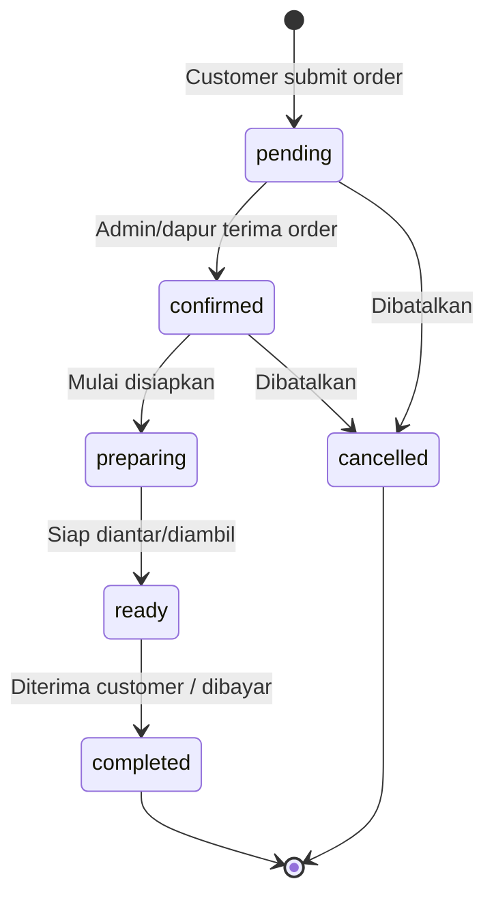
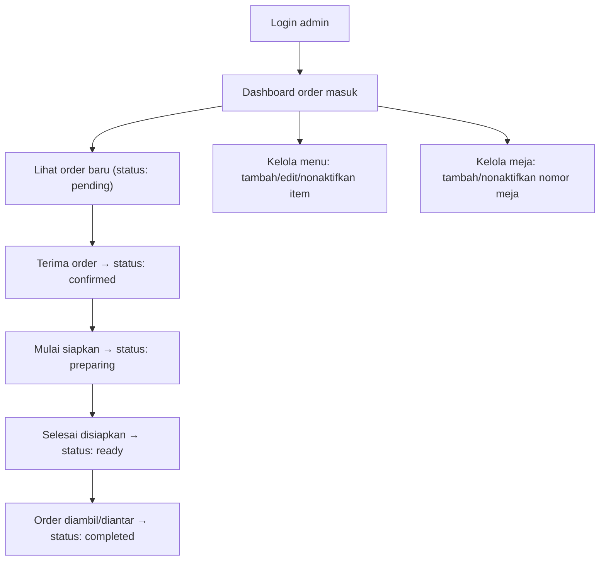

# Alur Aplikasi

Skema database terkait ada di [database.md](./database.md).

## 1. Alur pemesanan customer (sudah berjalan di frontend)

Implementasi saat ini (lihat [`DaftarMenu.vue`](../frontend/src/modules/customers/menu/DaftarMenu.vue),
[`OrderSummarySheet.vue`](../frontend/src/modules/customers/menu/OrderSummarySheet.vue),
[`useCart.js`](../frontend/src/modules/customers/menu/useCart.js)) menyimpan keranjang
di memori (tidak ke backend) dan hanya menampilkan snackbar sukses setelah submit — belum benar-benar
mengirim order ke server atau mengisi tab **Pesanan**/**Riwayat**. Bagian "rencana integrasi backend"
di bawah menjelaskan apa yang perlu ditambahkan.

## 2. Status pesanan

Pemetaan ke tab customer:
- **Pesanan** → `pending`, `confirmed`, `preparing`, `ready` (order yang masih berjalan)
- **Riwayat** → `completed`, `cancelled` (order yang sudah final)

## 3. Alur admin/dapur (rencana — modul `frontend/src/modules/admin` masih kosong)

## 4. Rencana integrasi backend (belum dikerjakan)

Langkah yang menghubungkan frontend saat ini ke alur di atas secara nyata:

1. Ganti `menuItems` hardcoded di `DaftarMenu.vue` dengan fetch ke `GET /menu-items` (join `categories`).
2. Saat "Buat Pesanan" ditekan di `OrderSummarySheet.vue`, kirim `POST /orders` berisi `table_number`, `session_id`, dan daftar item keranjang — bukan hanya `clear()` lokal.
3. Simpan `session_id` acak di `localStorage` sekali per perangkat (dibuat saat pertama kali buka app), dikirim di setiap request order.
4. `PesananPage.vue` fetch `GET /orders?session_id=...&status=active` untuk menampilkan order berjalan, idealnya polling atau websocket agar status update (mis. `preparing` → `ready`) terlihat real-time.
5. `RiwayatPage.vue` fetch `GET /orders?session_id=...&status=final`.
6. Modul admin (saat dibangun): halaman daftar order dengan aksi ubah status (`PATCH /orders/:id/status`), dan CRUD menu/kategori/meja.
