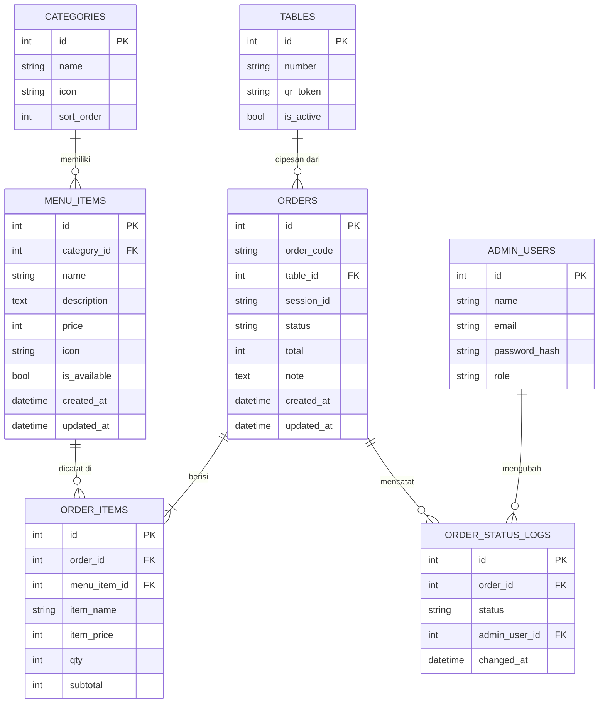

# Skema Database

> Status: **rancangan**. Backend & database belum dibuat — proyek ini saat ini baru
> frontend dengan data menu hardcoded di [`DaftarMenu.vue`](../frontend/src/modules/customers/menu/DaftarMenu.vue).
> Dokumen ini jadi acuan skema saat backend mulai dikerjakan.

## Entity Relationship Diagram

## Tabel

### `categories`
Kategori menu (Kopi, Non-Kopi, Makanan, Snack, Dessert — saat ini masih diturunkan otomatis dari field `category` tiap item di `DaftarMenu.vue`).

| Kolom | Tipe | Keterangan |
|---|---|---|
| id | int, PK | |
| name | string, unique | Nama kategori |
| icon | string | Nama icon mdi, contoh `mdi-coffee-outline` |
| sort_order | int | Urutan tampil di chip filter |

### `menu_items`
Satu baris = satu item menu yang tampil di grid menu.

| Kolom | Tipe | Keterangan |
|---|---|---|
| id | int, PK | |
| category_id | int, FK → categories.id | |
| name | string | |
| description | text | |
| price | int | Harga dalam Rupiah, tanpa desimal |
| icon | string | Icon mdi untuk thumbnail |
| is_available | bool | Kontrol status "Habis" di kartu menu |
| created_at / updated_at | datetime | |

### `tables`
Daftar meja yang bisa dipilih customer. Dibuat sebagai tabel terpisah (bukan sekadar angka bebas) supaya admin bisa membatasi nomor meja yang valid dan, ke depan, menautkan QR code per meja.

| Kolom | Tipe | Keterangan |
|---|---|---|
| id | int, PK | |
| number | string, unique | Nomor/label meja yang dilihat customer, contoh `"12"` |
| qr_token | string, nullable | Token unik untuk QR code per meja (rencana: `/?table=<token>` auto-isi nomor meja) |
| is_active | bool | Nonaktifkan meja tanpa menghapus riwayat order-nya |

### `orders`
Satu pesanan = satu transaksi dari sheet "Ringkasan Pesanan".

| Kolom | Tipe | Keterangan |
|---|---|---|
| id | int, PK | |
| order_code | string | Kode pendek untuk ditampilkan ke customer/dapur, contoh `ORD-20261027-0007` |
| table_id | int, FK → tables.id | |
| session_id | string | Lihat catatan **"Tanpa login"** di bawah |
| status | string (enum) | `pending`, `confirmed`, `preparing`, `ready`, `completed`, `cancelled` — lihat [alur-aplikasi.md](./alur-aplikasi.md) |
| total | int | Jumlah seluruh `order_items.subtotal` |
| note | text, nullable | Catatan customer (belum ada di UI, disiapkan untuk pengembangan lanjut) |
| created_at / updated_at | datetime | |

### `order_items`
Rincian item per pesanan. Harga & nama **disalin (snapshot)** saat order dibuat, bukan join langsung ke `menu_items`, supaya histori pesanan tidak berubah kalau harga/nama menu diedit admin di kemudian hari.

| Kolom | Tipe | Keterangan |
|---|---|---|
| id | int, PK | |
| order_id | int, FK → orders.id | |
| menu_item_id | int, FK → menu_items.id | |
| item_name | string | Snapshot nama saat order dibuat |
| item_price | int | Snapshot harga satuan saat order dibuat |
| qty | int | |
| subtotal | int | `item_price * qty` |

### `order_status_logs`
Jejak perubahan status order, dipakai admin/dapur untuk tracking dan untuk detail riwayat customer.

| Kolom | Tipe | Keterangan |
|---|---|---|
| id | int, PK | |
| order_id | int, FK → orders.id | |
| status | string | Status baru |
| admin_user_id | int, FK → admin_users.id, nullable | Null kalau perubahan otomatis sistem |
| changed_at | datetime | |

### `admin_users`
Untuk modul admin (`frontend/src/modules/admin`, saat ini masih folder kosong).

| Kolom | Tipe | Keterangan |
|---|---|---|
| id | int, PK | |
| name | string | |
| email | string, unique | |
| password_hash | string | |
| role | string (enum) | `admin`, `kasir`, `dapur` |

## Catatan desain

**Tanpa login customer.** Dari UI yang ada (tidak ada halaman login/profil untuk customer), pemesanan bersifat anonim per meja. Supaya tab **Pesanan** bisa menampilkan "pesanan saya" tanpa akun, frontend perlu menyimpan `session_id` acak (misal di `localStorage`) lalu mengirimkannya saat membuat order. Tab Pesanan & Riwayat memfilter berdasarkan `session_id` ini, bukan user login.

**Snapshot harga di `order_items`.** Mencegah nilai nominal di riwayat pesanan berubah kalau harga menu di-update admin setelah order dibuat.

**Pemetaan status ke UI:**
- Tab **Pesanan** → order dengan status `pending`, `confirmed`, `preparing`, `ready`.
- Tab **Riwayat** → order dengan status `completed` atau `cancelled`.

Detail transisi status ada di [alur-aplikasi.md](./alur-aplikasi.md).
